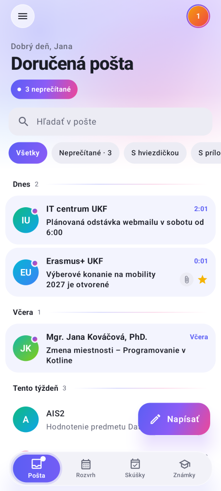
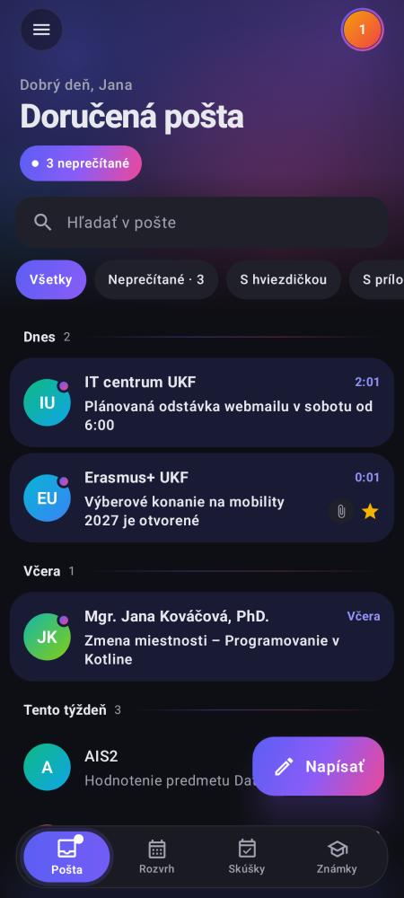
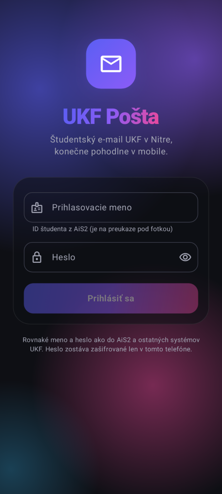
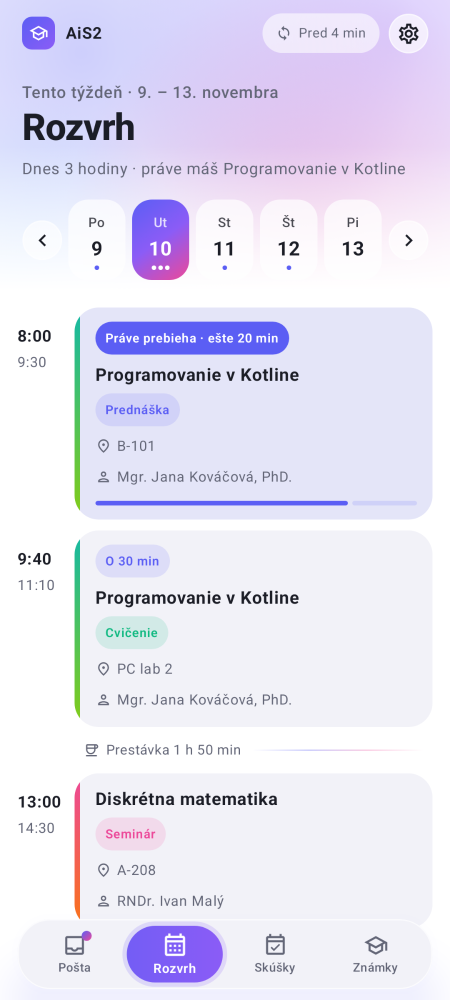
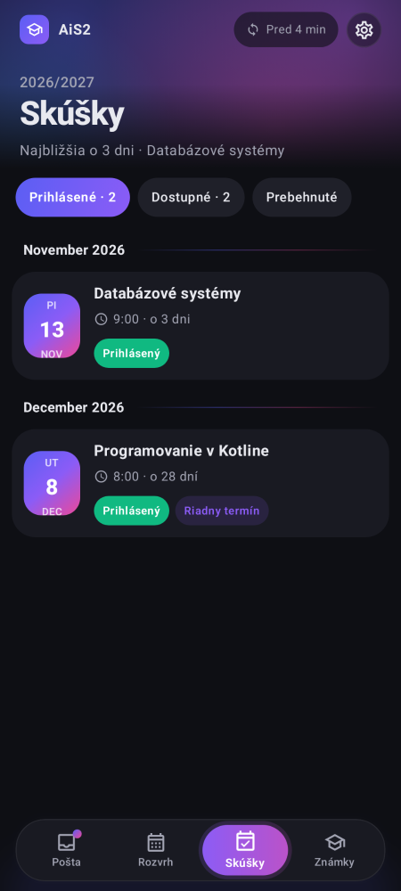
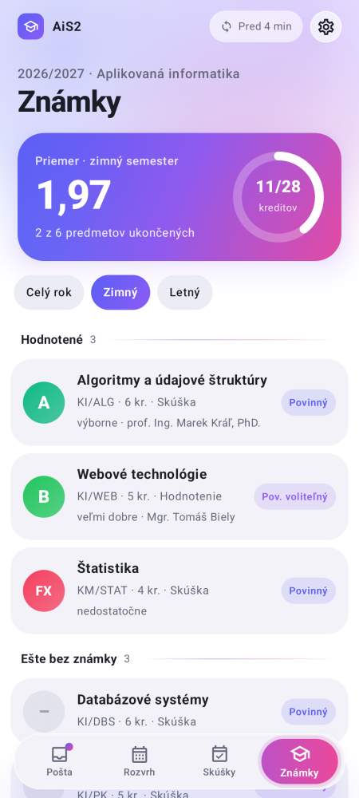

# UKF Pošta

An unofficial Android app for UKF Nitra students: student email (studentmail.ukf.sk) and the important parts of AiS2 (timetable, exams, grades) in one place, with notifications and a modern design instead of the 2010-era webmail.

> Not made by or affiliated with UKF. The app talks only to studentmail.ukf.sk (with the settings UKF publishes for mail clients) and to ais2.ukf.sk (through the same API the official AiS2 "Študent" web app uses).

<p align="center">
  
  
  
</p>
<p align="center">
  
  
  
</p>

## Download

**[⬇️ UKF Pošta for Android](../../releases/latest)**: download the `.apk` from the latest release.

## What it does

- **Notifications for new mail.** Every 15, 30 or 60 minutes the app checks the inbox in the background. Each new email gets its own notification with the sender and subject. Tap it to open the email, or tap **Označiť ako prečítané** (mark as read). Notifications for mail you've read elsewhere go away on their own.
- **Inbox** grouped by day (Dnes, Včera, Tento týždeň…), with gradient sender avatars, stars and attachment icons. Filters for unread, starred and attachments. Swipe a message right to mark it read or unread; swipe sideways anywhere to move between the tabs. Pull down to refresh; older mail loads as you scroll. Search covers sender and subject.
- **Folders** (Inbox, Sent, Drafts, Trash, Spam and your own) with unread counts, in the side menu. With POP3, which has no folders on the server, **Odoslané** (Sent) keeps a copy of everything sent from the app on the phone.
- **Reading** HTML and plain-text mail, with embedded images and attachments you can open. Images from the internet stay hidden until you tap **Zobraziť**. Links open only when you tap them; a mail can't open pages or other apps by itself.
- **Writing** new mail, reply, reply all and forward, with attachments up to the server's 15 MB limit. Recipients become bubbles like in Gmail, and people you've written to before are suggested as you type (diacritics don't matter: "stef" finds Štefan). Pick the **Od** (From) address from the ones you add in settings.
- **Dark mode** that follows the phone.

### AiS2

The tab bar at the bottom switches between **Pošta**, **Rozvrh**, **Skúšky** and **Známky**. AiS2 uses the same login as the mail; if yours differs, the app asks for it once.

- **Rozvrh**: the week from AiS2's own calendar export, day by day, with the lesson that's on now (and how long it has left), the next one, rooms, teachers and breaks.
- **Skúšky**: signed-up, available and past exam terms. Tap one for the room, examiners, capacity and deadlines, and to sign up or sign off.
- **Známky**: grades per semester with credits, the average and how many credits you have so far.
- **Notifications** (checked hourly): a new grade, new exam terms, and a reminder the day before an exam you're signed up for.
- **What mail says, in the timetable**: the app reads mail from UKF staff, the rector's office and Moodle (offline, on the phone) and marks the days: a cancelled lesson is crossed out with the teacher's sentence ("dňa 27. októbra nebudeme mať výučbu"), a rector's or dean's day off covers the lessons it applies to, and excursions, tests and Moodle deadlines appear between the lessons. Public holidays are marked too. Tap one to open the mail.
- Everything stays readable offline from the last download.

## Install

Requires Android 8.0 or newer. Open the `UKF-Posta-x.y.z.apk` from the latest release on the phone (allow installing unknown apps if asked), then sign in with your student ID (the number under the photo on your student card) and your UKF password, and allow notifications.

On Samsung phones, open **Notifikácie a účet** (tap your avatar in the search bar) and tap **Povoliť beh na pozadí**, so notifications aren't delayed.

## Connection

UKF's published settings for students, over SSL:

| | Server | Port |
|---|---|---|
| Incoming (IMAP, tried first) | studentmail.ukf.sk | 993 |
| Incoming (POP3, fallback) | studentmail.ukf.sk | 995 |
| Outgoing (SMTP) | studentmail.ukf.sk | 465 |

With POP3 there are no folders and read state is kept in the app.

The SMTP server on 465 only offers TLS 1.0, which current Android no longer has, so sending alone goes through a bundled [BouncyCastle](https://www.bouncycastle.org/) TLS stack. The server certificate is still checked against the phone's own root store; weak ciphers are off. Older phones (Android 8 to about 13) don't have the newer HARICA root yet, so the app bundles the official cross-signed certificate to the older HARICA root they do have. Checked on an Android 8.0 emulator (`app/src/androidTest`).

## Privacy

The password is encrypted with a key in the phone's Android Keystore and sent only to studentmail.ukf.sk and ais2.ukf.sk. Sent copies and recipient suggestions stay in the app's private storage on the phone. **Odhlásiť sa** deletes all of it.

## Build

```
./gradlew testDebugUnitTest assembleRelease
```

Screenshots on small phones, large fonts and a tablet: `./gradlew recordPaparazziDebug --tests '*DevicesScreenshotTest*'`. On a phone or emulator: `ANDROID_SERIAL=<device> ./gradlew connectedDebugAndroidTest`.

AiS2 answers are kept in the app's private files (`files/ais/`), which helps when AiS2 changes its data.

Signed with `ukf-posta.jks` / `keystore.properties` (kept out of git; back them up, or future updates won't install over this version).

## License

MIT, see [LICENSE](LICENSE). The app is provided as is, without warranty: check important things (exam sign-ups, deadlines) in AiS2 itself.
